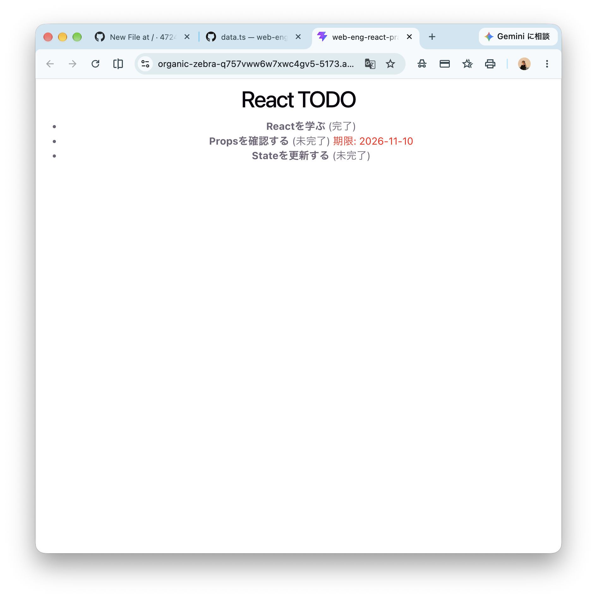

# 第8回 Webエンジニアリング演習 レポート

## 学籍番号
（学籍番号）

## コンポーネント構成
```
App
└── TodoList
    ├── TodoItem
    ├── TodoItem
    └── TodoItem
```

- `App` は `data.ts` の `todos` を読み込み、`TodoList` にPropsとして渡す
- `TodoList` は配列を `map` で回し、1件ごとに `TodoItem` を表示する
- `TodoItem` は1件のTODOを受け取り、タイトル・完了状態・期限を表示する

## `TodoItem`のProps型
```tsx
import type { Todo } from "../types";

type TodoItemProps = {
  todo: Todo;
};
```

`Todo` 型は `src/types.ts` で定義している。`dueDate` は `?` を付けた任意項目である。

```ts
export type Todo = {
  id: number;
  title: string;
  completed: boolean;
  dueDate?: string;
};
```

## 期限あり・なしの画面確認結果
`data.ts` で、id: 2 のTODOだけに過去の期限（`2026-11-10`）を設定した。

```ts
{ id: 2, title: "Propsを確認する", completed: false, dueDate: "2026-11-10" },
```

`TodoItem.tsx` では、`&&` による条件付きレンダリングで、期限があるTODOだけ日付を表示している。期限が今日より前の場合は赤文字にしている。

```tsx
const today = new Date().toLocaleDateString("sv-SE");
const isOverdue = todo.dueDate !== undefined && todo.dueDate < today;

{todo.dueDate && (
  <span style={{ color: isOverdue ? "red" : "inherit" }}>
    {" "}期限: {todo.dueDate}
  </span>
)}
```

確認結果:
| TODO | 期限 | 表示 |
|---|---|---|
| Reactを学ぶ | なし | 日付は表示されない |
| Propsを確認する | 2026-11-10（期限切れ） | 「期限: 2026-11-10」が赤文字で表示される |
| Stateを更新する | なし | 日付は表示されない |

以下、スクリーンショットです。publicではないため、クリックしても見れないかもしれないです。


`pnpm run build` も、型エラーなしで成功した。
